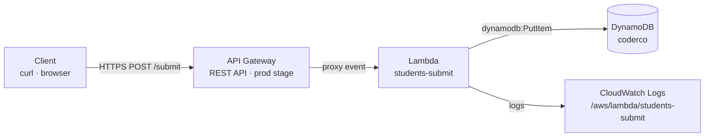
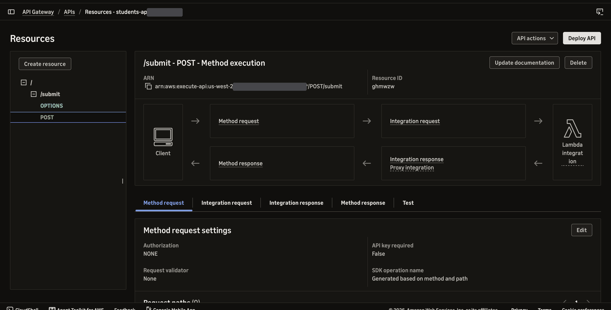
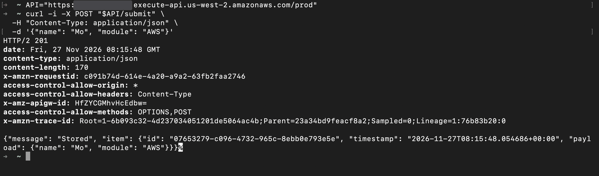
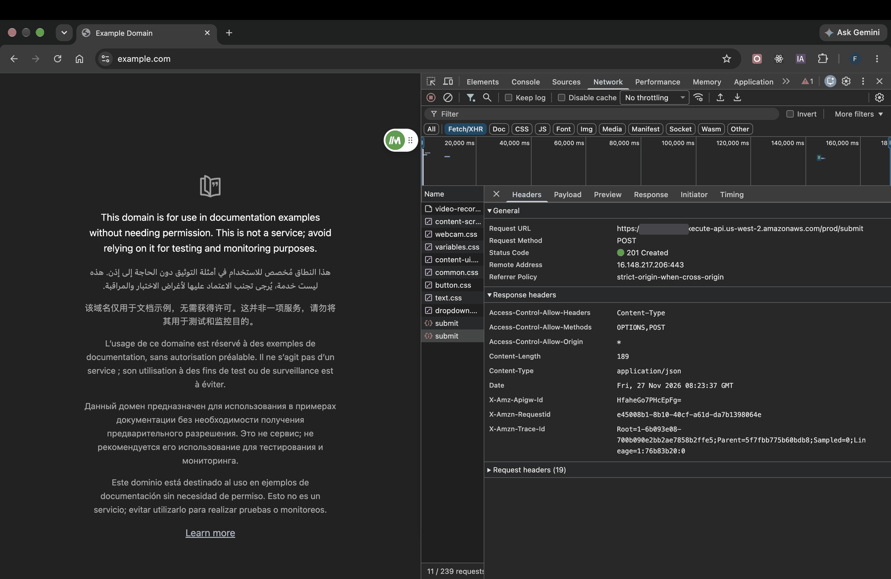
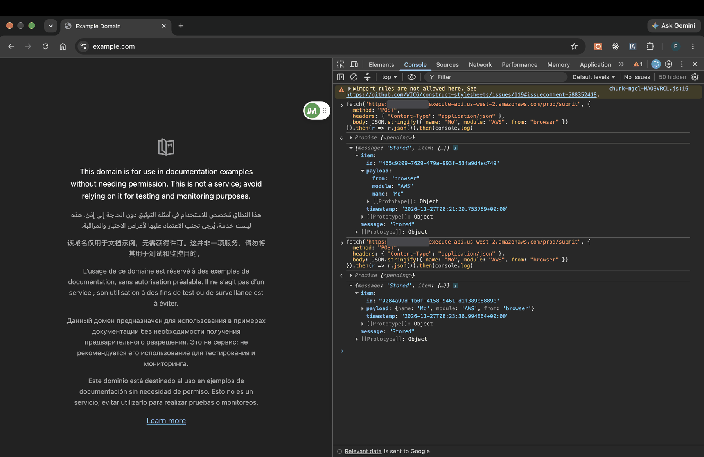
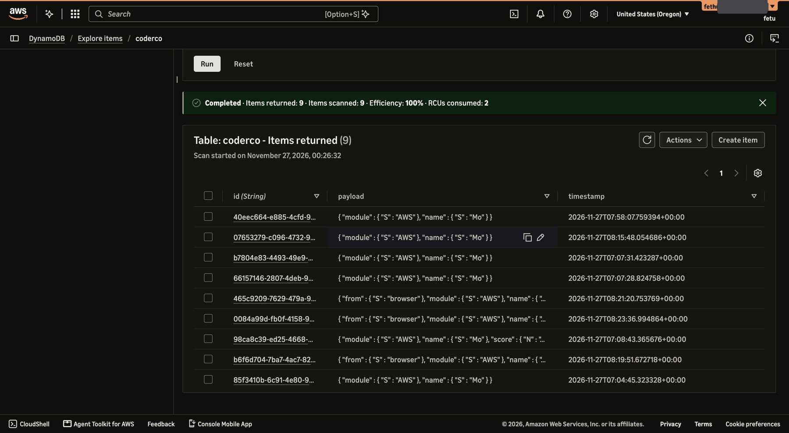
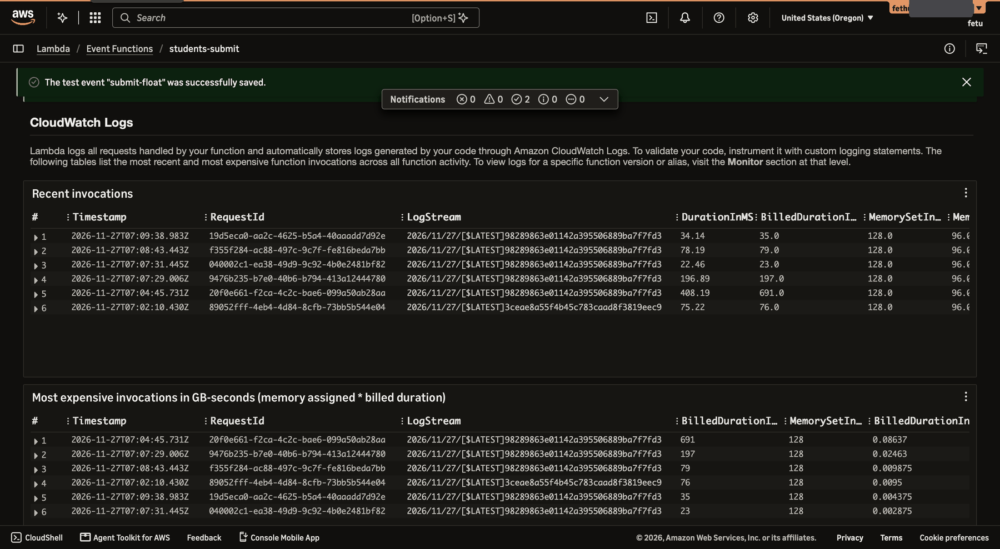
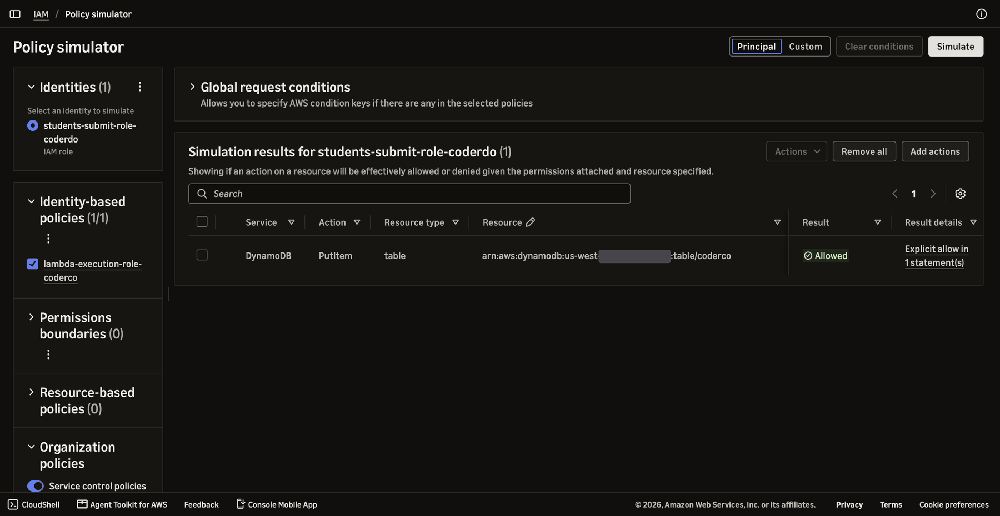
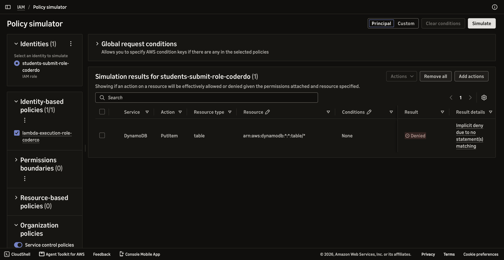

# Project 4: Serverless REST API with API Gateway, Lambda, and DynamoDB

A serverless REST API on AWS: **API Gateway** receives a JSON `POST`, a **Lambda** function written in Python validates it and adds an ID and a timestamp, **DynamoDB** stores it, and **CloudWatch** records every invocation. IAM is least-privilege on both sides of the function: on who can invoke it, and on what it can touch.

**Endpoint:** `POST https://<api-id>.execute-api.us-west-2.amazonaws.com/prod/submit`

> The API ID is left out of this repo on purpose. The endpoint doesn't require authentication yet, so anyone with the URL could write to the table. API keys, usage plans, and WAF rate limiting are listed under [Future integration points](#future-integration-points).

---

## Architecture



**Request flow (from a browser)**

1. **Preflight:** the browser sends `OPTIONS /submit` to check whether a cross-origin JSON POST is allowed. API Gateway answers it with a Mock integration (`200` plus `Access-Control-Allow-*` headers) without ever calling Lambda.
2. **Real request:** the browser sends `POST /submit`. API Gateway matches the route on the `prod` stage.
3. **Invoke permission:** the function's resource-based policy allows this API, and only this route, to invoke it.
4. **Proxy integration:** API Gateway passes the whole request (method, path, headers, body as a string) to Lambda as the `event`.
5. **Validation:** Lambda parses and validates the body. Invalid input returns `400` immediately, and nothing is written.
6. **Write:** Lambda builds `{ id, timestamp, payload }` and calls `PutItem`, using an execution role that can't do anything else.
7. **Response:** Lambda returns `statusCode`, `headers` (including CORS), and a JSON string `body`. API Gateway passes it through unchanged, and the browser checks `Access-Control-Allow-Origin` before handing the data to the page.

---

## Stack

| Layer | Service | Role |
|---|---|---|
| API | Amazon API Gateway (REST API, Regional) | Public HTTPS endpoint, routing, CORS preflight, stages |
| Compute | AWS Lambda (Python) | Validation, ID and timestamp generation, error handling |
| Database | Amazon DynamoDB (on-demand) | Stores each submission as one item |
| Observability | Amazon CloudWatch Logs | Per-invocation logs and duration/billing reports |
| Security | AWS IAM | Execution role (outbound) + resource-based policy (inbound) |

---

## Repository layout

```
.
├── README.md
├── lambda/
│   └── lambda_function.py         # The handler deployed to AWS
├── events/                        # API Gateway proxy test events (Lambda console / CLI)
│   ├── submit-ok.json
│   ├── submit-float.json
│   └── submit-bad-json.json
├── iam/
│   ├── execution-policy.json      # What Lambda can do
│   ├── trust-policy.json          # Who can assume the role (Lambda only)
│   └── lambda-resource-policy.json  # Who can invoke Lambda (this API only)
├── scripts/
│   ├── deploy-lambda.sh           # Zip and push new code to the function
│   └── test-api.sh                # Smoke-test the live endpoint
├── tests/
│   └── test_lambda_function.py    # Local tests with a mocked DynamoDB (moto)
├── requirements-dev.txt
└── docs/screenshots/
```

---

## What was built

### 1. DynamoDB table

| Setting | Value |
|---|---|
| Table name | `coderco` |
| Partition key | `id` (String) |
| Sort key | None |
| Capacity mode | On-demand (`PAY_PER_REQUEST`) |
| Encryption | Owned by Amazon DynamoDB (default) |

Only the key attribute is declared. `timestamp` and `payload` are ordinary attributes that Lambda adds to each item. Random UUIDs as partition keys spread writes evenly across partitions.

### 2. IAM: both sides of the function

| | Execution role | Resource-based policy |
|---|---|---|
| Question it answers | What can Lambda do? | Who can call Lambda? |
| Attached to | The role (`students-submit-role-coderdo`) | The function (`students-submit`) |
| Allows | `PutItem` on one table + writing to its own log group | Only this API's `POST /submit` |

**Execution policy** (`lambda-execution-role-coderco`, also in [`iam/execution-policy.json`](iam/execution-policy.json)):

```json
{
  "Version": "2012-10-17",
  "Statement": [
    {
      "Sid": "WriteStudents",
      "Effect": "Allow",
      "Action": "dynamodb:PutItem",
      "Resource": "arn:aws:dynamodb:us-west-2:<account-id>:table/coderco"
    },
    {
      "Sid": "WriteOwnLogs",
      "Effect": "Allow",
      "Action": ["logs:CreateLogGroup", "logs:CreateLogStream", "logs:PutLogEvents"],
      "Resource": [
        "arn:aws:logs:us-west-2:<account-id>:log-group:/aws/lambda/students-submit",
        "arn:aws:logs:us-west-2:<account-id>:log-group:/aws/lambda/students-submit:*"
      ]
    }
  ]
}
```

What makes it least-privilege is what's missing:

- **One action.** The function can't read, scan, update, or delete anything.
- **One table.** There's no `table/*`, so every other table in the account is off-limits.
- **One log group.** The AWS managed `AWSLambdaBasicExecutionRole` allows writing to *every* log group (`Resource: "*"`). This policy doesn't.
- The trust policy ([`iam/trust-policy.json`](iam/trust-policy.json)) lets only `lambda.amazonaws.com` assume the role.

**Resource-based policy** (created when API Gateway was integrated, see [`iam/lambda-resource-policy.json`](iam/lambda-resource-policy.json)):

```json
"Principal": { "Service": "apigateway.amazonaws.com" },
"Action": "lambda:InvokeFunction",
"Condition": {
  "ArnLike": {
    "AWS:SourceArn": "arn:aws:execute-api:us-west-2:<account-id>:<api-id>/*/POST/submit"
  }
}
```

The `SourceArn` condition is the important part. Without it, any API Gateway API in *any* AWS account that knew the function's ARN could invoke it.

### 3. Lambda function

| Setting | Value |
|---|---|
| Name | `students-submit` |
| Runtime / architecture | Python 3 / arm64 |
| Handler | `lambda_function.lambda_handler` |
| Environment variable | `TABLE_NAME=coderco` |
| Execution role | `students-submit-role-coderdo` |

**Behaviour**

| Input | Status | Response body |
|---|---|---|
| Valid JSON object | `201` | `{"message": "Stored", "item": {...}}` |
| Invalid JSON | `400` | `{"error": "Body must be valid JSON", "requestId": "..."}` |
| Empty body | `400` | `{"error": "Request body is required", ...}` |
| JSON that isn't an object (`[1, 2]`, `{}`) | `400` | `{"error": "Body must be a non-empty JSON object", ...}` |
| DynamoDB rejects the write | `500` | `{"error": "Could not save the item", ...}` |
| Any unexpected exception | `500` | `{"error": "Internal error", ...}` |

**Stored item**

```json
{
  "id": "07653279-c096-4732-965c-8ebb0e793e5e",
  "timestamp": "2026-11-27T08:15:48.054686+00:00",
  "payload": { "name": "Mo", "module": "AWS" }
}
```

**Design decisions**

- **A single exit point (`respond()`).** With proxy integration, Lambda owns the whole HTTP response. Every path, errors included, returns the same `statusCode` / `headers` / string `body` shape with the CORS headers attached. A malformed response would surface as a `502` from API Gateway.
- **`json.loads(..., parse_float=Decimal)`.** boto3 rejects Python `float` values for DynamoDB. Parsing decimals as `Decimal` means `{"score": 9.5}` is stored as a DynamoDB number (`N`) instead of crashing the function. `_to_json` converts it back for the response.
- **A catch-all `except` that still returns JSON with CORS headers.** Without it, an unexpected bug becomes a bare `502` with no CORS headers, which a browser reports as a misleading CORS error.
- **The client is created at module level.** `boto3.resource(...)` runs once per cold start and is reused by warm invocations (see the timings below).
- **Logs record IDs, not payloads.** Every request can be traced by its request ID without writing submitted data into the logs.

### 4. API Gateway

| Setting | Value |
|---|---|
| API type | REST API (`students-api`) |
| Endpoint type | Regional (us-west-2) |
| Resource | `/submit` |
| `POST` | Lambda proxy integration → `students-submit` |
| `OPTIONS` | Mock integration (CORS preflight) |
| Gateway responses | Default 4XX / 5XX include CORS headers |
| Stage | `prod` |

**Why a REST API rather than an HTTP API:** HTTP APIs are cheaper and simpler, but API keys, usage plans, and AWS WAF (all on the roadmap below) are only supported on REST APIs.

**CORS with proxy integration has two halves:**

| Request | Answered by | CORS headers come from |
|---|---|---|
| `OPTIONS` (preflight) | API Gateway | Mock integration created by *Enable CORS* |
| `POST` (actual call) | Lambda | `CORS_HEADERS` in the function code |

Ticking *Default 4XX* and *Default 5XX* matters too. Those errors (throttling, missing API key, invoke-permission failures) are generated by API Gateway itself and never reach Lambda.

---

## Testing and verification

### API Gateway → Lambda wiring

`/submit` with `OPTIONS` (CORS preflight) and `POST` (Lambda proxy integration):



### curl against the live endpoint

```bash
API="https://<api-id>.execute-api.us-west-2.amazonaws.com/prod"

curl -i -X POST "$API/submit" \
  -H "Content-Type: application/json" \
  -d '{"name": "Mo", "module": "AWS"}'
```

```
HTTP/2 201
content-type: application/json
access-control-allow-origin: *
access-control-allow-headers: Content-Type
access-control-allow-methods: OPTIONS,POST

{"message": "Stored", "item": {"id": "07653279-c096-4732-965c-8ebb0e793e5e", "timestamp": "2026-11-27T08:15:48.054686+00:00", "payload": {"name": "Mo", "module": "AWS"}}}
```



### Browser CORS test

`curl` ignores CORS entirely, so the real test is a browser on a different origin. This was run from the DevTools console on `https://example.com`:

```javascript
fetch("https://<api-id>.execute-api.us-west-2.amazonaws.com/prod/submit", {
  method: "POST",
  headers: { "Content-Type": "application/json" },
  body: JSON.stringify({ name: "Mo", module: "AWS", from: "browser" })
}).then(r => r.json()).then(console.log)
```

A cross-origin `POST` with `Content-Type: application/json` only goes through after a successful preflight, so a `201` here proves both halves of CORS work.





### Error handling

| Case | Expected | Verified with |
|---|---|---|
| Valid payload | `201` | curl, browser, Lambda console test event |
| Payload with a decimal (`9.5`) | `201`, stored as `N` | Lambda console test event (`submit-float.json`) |
| Invalid JSON | `400` | Lambda console test event (`submit-bad-json.json`) |
| Empty body, non-object body | `400` | Local tests |
| DynamoDB failure | `500` with CORS headers | Local tests (table deleted mid-test) |

**Local tests:** the handler runs against a mocked DynamoDB, so no AWS account is needed.

```bash
pip install -r requirements-dev.txt
pytest -v
# 9 passed
```

**Live smoke test** (covers the happy path, error cases, the preflight, and an unknown route):

```bash
export API_URL="https://<api-id>.execute-api.us-west-2.amazonaws.com/prod"
./scripts/test-api.sh
```

### DynamoDB

Items from curl, the browser (`"from": "browser"`), and the Lambda console. The decimal test is stored as a number: `"score": {"N": "9.5"}`.



### CloudWatch: cold start vs warm invocations



| Invocation | Duration | Billed | Why |
|---|---|---|---|
| First call on a new container | 408 ms | 691 ms | Cold start. The runtime loads, boto3 imports, and the table client is built. Billing includes the init phase. |
| Later calls, same container | 22–197 ms (most under 80 ms) | 23–197 ms | Warm. Only the `PutItem` runs. |

Memory: 128 MB configured, about 96 MB used. Each `LogStream` is one execution environment. A new stream appears after a code deploy, because Lambda replaces the container.

### Least privilege: IAM Policy Simulator

| Action | Resource | Result |
|---|---|---|
| `dynamodb:PutItem` | `arn:aws:dynamodb:us-west-2:<account-id>:table/coderco` | **Allowed** |
| `dynamodb:PutItem` | `arn:aws:dynamodb:*:*:table/*` (any other table) | **Denied** (implicit deny) |





---

## Troubleshooting log

### curl: `URL rejected` and `Could not resolve host: curl`

**Symptom:** the first live test failed with three errors at once: `Port number was not a decimal number`, `Could not resolve host: curl`, and `No host part in the URL`.

**Root cause:** three shell mistakes on one line:
- A `$` in front of the literal URL (`"$https://..."`). The shell treated `$https` as an undefined variable and replaced it with nothing.
- Two `curl` commands pasted on the same line, so the second `curl` was read as a URL.
- `$API` was used without ever being set, so the URL became just `/submit/submit`.

**Fix:** set the base URL once (`API="https://...amazonaws.com/prod"`), confirm it with `echo $API`, then run each command separately. The result was `HTTP/2 201`.

**Lesson:** when a command fails with several errors at once, read them as one chain. Each error usually points to a separate typo on the same line.

---

## Gotchas this design handles

| Gotcha | What happens | How it's handled here |
|---|---|---|
| Body arrives as a string | `event["body"]["name"]` crashes | `json.loads` on the body, with validation |
| Floats in the payload | boto3 raises `Float types are not supported` | `parse_float=Decimal` |
| Wrong proxy response shape | API Gateway returns `502` | Every path goes through `respond()` |
| CORS with proxy integration | *Enable CORS* only covers `OPTIONS` | Lambda adds CORS headers to every response |
| Errors generated by API Gateway | No CORS headers, so the browser shows a fake CORS error | Default 4XX/5XX gateway responses include CORS |
| Edits not live | The stage still serves the old snapshot | Redeploy to `prod` after every change |
| `403 Missing Authentication Token` | Misleading error for a wrong path or method | Check the URL and `/prod` first |
| Missing invoke permission (IaC) | `500`, and the logs say `Invalid permissions on Lambda function` | Resource-based policy (`aws_lambda_permission` in Terraform) |

---

## Key takeaways

- **Lambda permissions have two sides.** The execution role controls what the function can do. The resource-based policy controls who can invoke it. The console creates the second one for you, but Terraform and the CLI don't.
- **Proxy integration hands the whole HTTP contract to the code.** Lambda must return `statusCode`, `headers`, and a string `body` on every path.
- **CORS is enforced by browsers only.** A working `curl` proves nothing about CORS. A cross-origin `fetch` does.
- **Status codes show where a failure happened.** A `400` or a JSON `500` comes from the code. A `502`, a bare `500`, or a `403 Missing Authentication Token` comes from API Gateway.
- **Cold starts are visible and measurable.** Setup that runs once at module level (408 ms on a cold start) is reused, so warm invocations mostly finish in under 80 ms.

---

## Future integration points

### `GET /students`
- A **separate** Lambda with its own role that allows only `dynamodb:Scan` on this table. Adding `Scan` to the write function's role would give it read access it never uses.
- Paginate with `LastEvaluatedKey`, because a single `Scan` returns at most 1 MB.

### API keys and usage plans
- Require an API key on `POST /submit`, and attach the key to a usage plan with throttling (rate and burst) and a quota.
- Clients send the key in the `x-api-key` header (already allowed by the CORS configuration).
- Keep `OPTIONS` key-free. Browsers never send custom headers on a preflight, so requiring a key there breaks CORS.

### AWS WAF
- A web ACL on the `prod` stage with a **rate-based rule** that blocks an IP after it exceeds a request threshold.
- Optionally add AWS managed rule groups (common rule set, known bad inputs).
- Cost note: WAF bills per web ACL and per rule every month, even without traffic.

### Custom domain with ACM
- `api.fetudeen.com` as a **Regional** custom domain, with the ACM certificate requested in **us-west-2**, the same region as the API. That's unlike CloudFront, which requires us-east-1.
- Map the domain to the `prod` stage with an API mapping, then add a Route 53 alias A record pointing at the custom domain's regional endpoint.

### Other improvements
- **Infrastructure as Code:** rebuild the table, role, function, permission, API, and stage as a Terraform module.
- **Restrict CORS:** replace `Access-Control-Allow-Origin: *` with the real front-end origin.
- **Request validation:** reject malformed bodies at API Gateway with a JSON Schema model, before Lambda is billed.
- **Structured logs and tracing:** Lambda's JSON log format plus AWS X-Ray for request tracing.
- **Data protection:** DynamoDB point-in-time recovery, and deletion protection on the table.

---

## Cleanup

```bash
REGION=us-west-2

aws apigateway delete-rest-api --rest-api-id <api-id> --region $REGION
aws lambda delete-function --function-name students-submit --region $REGION
aws logs delete-log-group --log-group-name /aws/lambda/students-submit --region $REGION
aws dynamodb delete-table --table-name coderco --region $REGION

# A role can only be deleted once no policies are attached
aws iam detach-role-policy --role-name students-submit-role-coderdo \
  --policy-arn arn:aws:iam::<account-id>:policy/lambda-execution-role-coderco
aws iam delete-policy --policy-arn arn:aws:iam::<account-id>:policy/lambda-execution-role-coderco
aws iam delete-role --role-name students-submit-role-coderdo
```

---

## Author

**Fetudin Mohammed (Fatu)**
[LinkedIn](https://linkedin.com/in/fetudeen) · [GitHub](https://github.com/Fetu-Deen)
